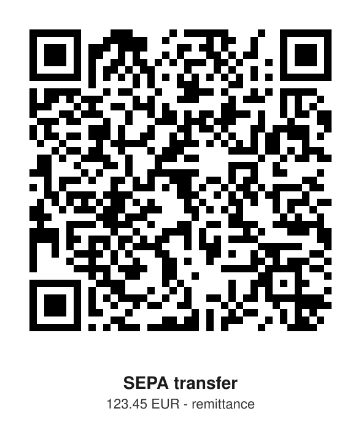

# sepa-qr-svg

Self-verifying, offline EPC069-12 (GiroCode) payment QR code generator. Produces an SVG that European banking apps (George, ELBA, ING, Sparkasse, and others) read through their QR scan feature as a prefilled SEPA credit transfer.

No dependencies beyond Python 3: the QR encoder is the vendored Nayuki qrcodegen (MIT), everything else is standard library. No network, no accounts, no data leaving the machine.

## Why this one

EPC QR generators exist in numbers. This one refuses to trust its own output: after rendering, the matrix is decoded again from scratch - format information BCH check (both copies), unmasking, codeword extraction, de-interleaving, Reed-Solomon check per block - and the decoded payload must match the EPC payment text byte for byte. Any mismatch aborts with a non-zero exit before an SVG is written, so an unverifiable code never reaches an invoice.

`SKILL.md` wraps this as an agent skill: coding agents get the run-and-verify discipline (generate, verify, deliver only on `Verification OK`) without a network tool or a package install.

## Usage

```bash
python3 sepa_qr_svg.py \
  --iban "AT04 3141 5000 0000 0123" \
  --name "Musterfirma Müller GmbH" \
  --amount 123.45 \
  --bic BANKATWW \
  --ref "Invoice 2026-000123" \
  --out sepa-qr.svg \
  --title "SEPA transfer" \
  --subtitle "123.45 EUR - remittance"
```

Example output (dummy data, scannable):



Amounts accept dot or comma. Umlauts are fine (UTF-8 payload). `--title` / `--subtitle` add captions under the code.

## EPC payload (version 002)

| Line | Field | Constraints |
|---|---|---|
| 1-4 | `BCD`, `002`, `1`, `SCT` | fixed; 1 = UTF-8 |
| 5 | BIC | optional since 002 |
| 6 | Beneficiary name | 1-70 characters |
| 7 | IBAN | no spaces, ISO 7064 mod-97 checked |
| 8 | Amount | `EUR#.##`, euro only |
| 9-10 | Purpose, structured remittance | unused |
| 11 | Unstructured remittance | max 140 characters |
| 12 | Beneficiary-to-originator | unused |

Total payload limit: 331 bytes. A maximal payload lands at QR version 12; the verifier handles the 8-bit and 16-bit BYTE count fields, so every reachable version is covered.

## Limitations

- SVG output only (no PNG), single fixed format: version 002, UTF-8, unstructured remittance.
- The IBAN checksum is validated; account existence is not. This generates a payment request only - it never moves money, and the transfer is always confirmed in the banking app.
- Test the code with your target banking app before production use.

## License

MIT, see [LICENSE](LICENSE). `qrcodegen.py` is (c) Project Nayuki (MIT License), included as a vendored copy.
